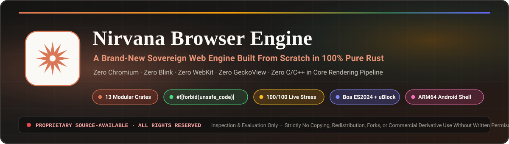
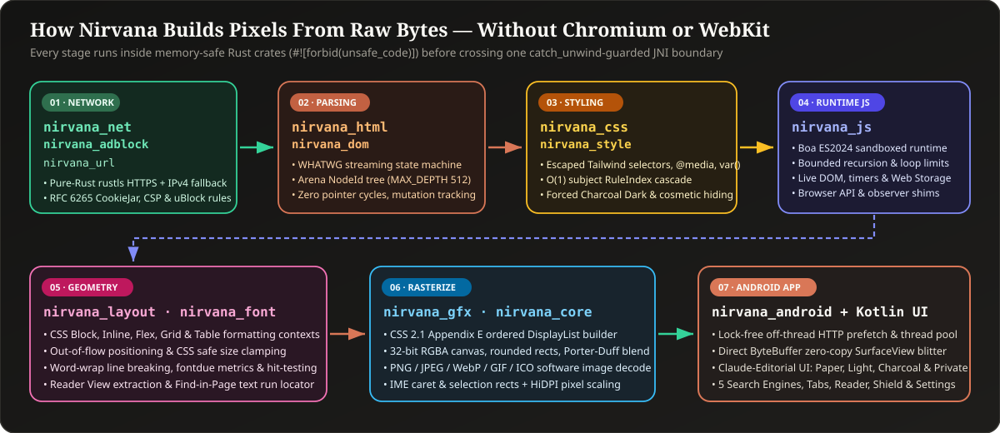
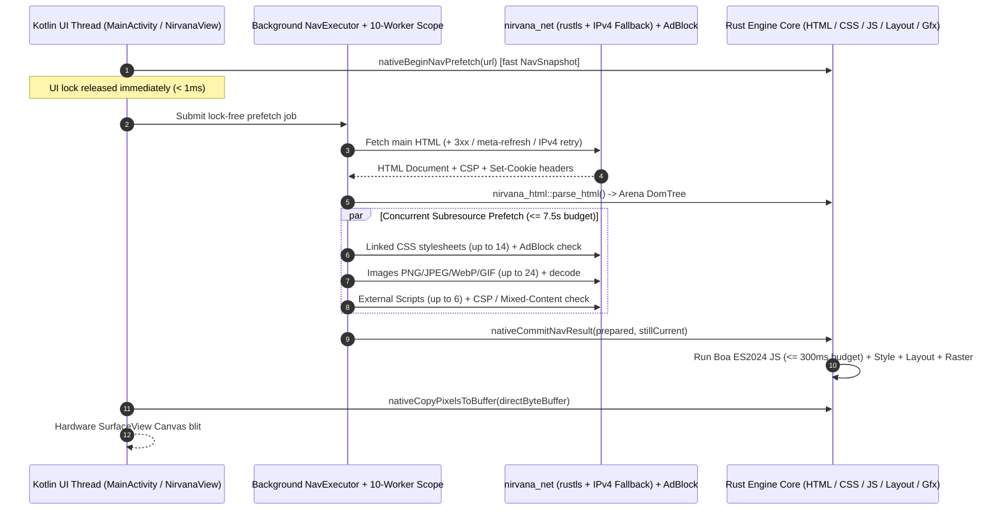
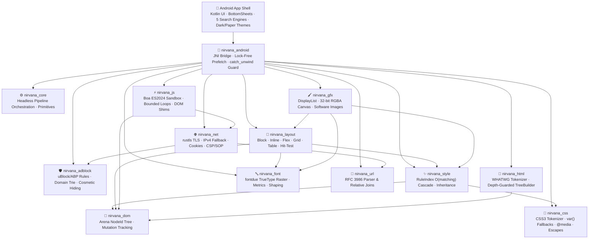
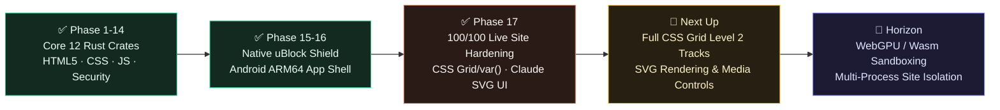

<div align="center">

<a href="https://github.com/viroaryan/browserengine">
  
</a>

<br/><br/>

[](Cargo.toml)
[-2F6F4E?style=for-the-badge&logo=shield&logoColor=white)](#security--memory-guarantees)
[](#workspace-crate-topology)
[](#verified-benchmarks--live-stress-results)
[](android)
[](LICENSE)

<br/>

### ⚡ *Stop Wrapping Chromium. We Are Building a Totally New Browser Engine From Scratch.* ⚡

[Why Nirvana](#-why-build-a-brand-new-browser-engine-from-scratch) • [Architecture](#-end-to-end-rendering-pipeline) • [13 Crates](#-workspace-crate-topology) • [Benchmarks](#-verified-benchmarks--live-stress-results) • [Android UI](#-claude-inspired-mobile-browser-shell) • [Build](#-building--testing) • [Strict License](#-strict-proprietary-license)

</div>

---

> [!CAUTION]
> **STRICT PROPRIETARY SOURCE-AVAILABLE LICENSE (`ALL RIGHTS RESERVED`)**
> This repository is published **strictly for inspection, technical evaluation, and architectural study**. Copying, forking for redistribution, extracting crates/parsers/renderers into third-party browsers, or commercial reuse is **strictly prohibited** without prior written permission from the author ([@viroaryan](https://github.com/viroaryan)). Read full binding terms in [LICENSE](LICENSE) and [NOTICE](NOTICE).

---

## 🔥 Why Build a Brand-New Browser Engine From Scratch?

Modern Android "independent" browsers aren't actually independent—almost all of them silently embed **Android System WebView (Blink)**, **Chromium**, **WebKit**, or **GeckoView**. That brings tens of millions of lines of legacy C++, unpredictable memory safety bugs, giant binary footprints, and zero true architectural sovereignty.

**Nirvana Browser Engine** throws away the wrappers and starts from bare bytes:

- 🦀 **Zero C/C++ in the Core Engine:** No Blink. No WebKit. No GeckoView. No Skia C++. Every layer—from HTTP/TLS sockets to HTML5 tokenization, CSS cascade, Flexbox/Grid/Table geometry, software rasterization, AdBlock filtering, and JavaScript sandboxing—is engineered natively in **Rust Edition 2024**.
- 🛡️ **Compiler-Enforced Memory Safety (`#![forbid(unsafe_code)]`):** **12 out of 13 workspace crates** outright ban `unsafe` at compile time. Only the single thin JNI boundary (`nirvana_android`) permits `unsafe` and wraps every FFI entrypoint in `std::panic::catch_unwind`.
- 🧠 **Forging a Next-Generation Mobile Web Engine:** Built cleanly for speed, determinism, sub-millisecond telemetry, integrated native socket/cosmetic ad-blocking, and sovereign control over how the mobile web looks and executes.

| Capability | Legacy WebView / C++ Wrappers | **Nirvana Sovereign Engine** |
| :--- | :--- | :--- |
| **Rendering Core** | External OEM Blink / Gecko C++ blob | **100% Custom Pure-Rust 13-Crate Pipeline** |
| **Memory Safety** | Manual C++ lifetimes & UAF mitigations | **Compiler `#![forbid(unsafe_code)]` across all core crates** |
| **Ad & Tracker Shield** | External JS extensions or DNS hacks | **Native in-stack uBlock/ABP network, cosmetic CSS & scriptlet defusers** |
| **UI Thread Isolation** | Often couples network/layout stalls | **Lock-free off-thread prefetch snapshot + `ByteBuffer` zero-copy render** |
| **Telemetry** | Opaque black-box frame timings | **Per-stage microsecond timings (Parse / Style / Layout / Raster)** |

---

## 🎨 End-to-End Rendering Pipeline

<div align="center">
  
</div>

### Lock-Free Prefetch & Frame Commit Sequence

Nirvana cleanly decouples slow network I/O from interactive Android UI rendering so scrolling, gestures, menus, and tab switching stay responsive even while fetching heavy real-world pages with 10+ stylesheets and dozens of images concurrently:



---

## 🧩 Workspace Crate Topology

The workspace comprises **13 decoupled Rust crates** under `crates/` plus a clean **Kotlin + NDK Android application shell** under `android/`:



### Crate Engineering Matrix

| Crate | Policy | Engineering Responsibility |
| :--- | :--- | :--- |
| **`nirvana_url`** | `#![forbid(unsafe_code)]` | RFC 3986 URL parser, relative path resolution, host/port/query parsing. |
| **`nirvana_dom`** | `#![forbid(unsafe_code)]` | Arena-backed `DomTree` using typed `NodeId` indices (zero pointer cycles, clean mutation tracking). |
| **`nirvana_html`** | `#![forbid(unsafe_code)]` | WHATWG HTML5 streaming tokenizer, entity decoder, implied-tag recovery, recursion cap (`MAX_TREE_DEPTH = 512`). |
| **`nirvana_css`** | `#![forbid(unsafe_code)]` | CSS3 tokenizer (including escaped Tailwind utilities like `.wb\:hidden`), `@media`/`@supports` evaluation, `var(--x, fallback)` resolution, `flex-flow` & `border`/`font`/`margin` shorthands. |
| **`nirvana_style`** | `#![forbid(unsafe_code)]` | Subject-keyed `RuleIndex` (`by_id`, `by_class`, `by_tag`, `universal`), specificity cascade, `.sr-only` / `clip` / `-translate-x-full` drawer hiding, Dark mode overrides. |
| **`nirvana_layout`** | `#![forbid(unsafe_code)]` | Block Formatting Context, inline word-wrap cursor, CSS Flexbox & Grid flow, Table & standalone `TableRow` sizing, out-of-flow positioning, `css_clamp_size` safety. |
| **`nirvana_font`** | `#![forbid(unsafe_code)]` | Embedded TrueType typeface (`default_font.ttf`), `fontdue` metrics & line spacing, PUA icon tofu suppression. |
| **`nirvana_gfx`** | `#![forbid(unsafe_code)]` | CSS 2.1 Appendix E DisplayList, anti-aliased rounded rects & borders, Porter-Duff RGBA canvas, PNG/JPEG/WebP/GIF/ICO decoding, IME carets & text selection. |
| **`nirvana_js`** | `#![forbid(unsafe_code)]` | Sandboxed `boa_engine` ES2024 runtime with `loop_iteration_limit(200_000)` / `recursion_limit(256)`, JS `Array.prototype.sort` stability shim, browser API & observer shims, `localStorage`/`sessionStorage`, timers. |
| **`nirvana_net`** | `#![forbid(unsafe_code)]` | `ureq` + `rustls` / platform TLS networking, fast connect/global timeouts + automatic `Ipv4Only` fallback, RFC 6265 `CookieJar`, CSP, Mixed-Content, Same-Origin Policy. |
| **`nirvana_adblock`** | `#![forbid(unsafe_code)]` | In-stack ABP/uBlock network blocker, whitelist precedence, domain rules, cosmetic hiding rules, and scriptlet defusers. |
| **`nirvana_core`** | `#![forbid(unsafe_code)]` | Shared geometry primitives (`Point`, `Rect`, `Size`, `Rgba`) and unified arena foundations. |
| **`nirvana_android`** | Confined JNI FFI | Lock-free `NavSnapshot` prefetch, Reader View extraction, Find-in-Page match locator, hit-testing, IME input buffers, and `catch_unwind`-hardened JNI exports. |

---

## 📊 Verified Benchmarks & Live Stress Results

> [!TIP]
> All checks below were executed directly in this repository (`cargo test --workspace`, `--release` live 100-site stress harness, NDK `aarch64-linux-android` release cross-compile, and Gradle APK assembly + JUnit tests).

| Verification Suite | Scope & Targets | Measured Result |
| :--- | :--- | :--- |
| **`cargo test --workspace --no-fail-fast`** | All 13 sovereign Rust crates & unit/integration suites | **218 passed, 0 failed** (`1` `#[ignore]` stress suite) |
| **`top_100_sites_test` (`--release --ignored`)** | **100 real-world live websites** (Docs, OS portals, Wikis, News, Cloud, AI, Forums, Classic HTTP) rendered at `1080x2400 @ 2.75x` | **Loaded OK: 100/100 · Failed: 0 · Panics: 0 · Blank renders: 0** (`33.64s` total) |
| **Android JVM Unit Tests (`gradle testDebugUnitTest`)** | [BrowserModelsTest.kt](android/app/src/test/kotlin/com/nirvana/browser/data/BrowserModelsTest.kt) (5 engines, wall detection, SERP history, omnibox routing) | **3 passed, 0 failed, 0 skipped** |
| **Android `arm64-v8a` Native Binary & APK** | NDK release cross-compile (`libnirvana_engine.so`) + Gradle `assembleDebug` | **24.0 MB `.so` · `BUILD SUCCESSFUL`** |

<details>
<summary><b>Click to inspect how Nirvana handles hard real-world web edge cases cleanly</b></summary>

1. **CSS Sizing Conflict Immunity (`css_clamp_size`):** Responsive sites often generate `min-width > max-width` (e.g., `768px` min vs `100%` `392px` max on Wikipedia, Wiktionary, NPR, Indian Express). Nirvana clamps safely per CSS Sizing rules without panicking.
2. **Non-Transitive JS Comparator Protection:** Upstream Rust `slice::sort_by` panics on comparators like `() => 0.5 - Math.random()` used on legacy sites (`neverssl.com`). Nirvana's JS runtime installs a pure-JS merge sort shim plus execution/recursion limits and `std::panic::catch_unwind`.
3. **Dual-Stack / Stalled IPv6 Resilience:** Domains with broken IPv6 endpoints automatically fall back to `IpFamily::Ipv4Only` with tight connect deadlines, eliminating 15-second hangs while prefetching up to 14 stylesheets, 24 images, and 6 scripts concurrently under a `7.5s` budget.
4. **Responsive Flex/Grid/Offscreen Accuracy:** Parses CSS `var(..., fallback)`, `flex-flow: column nowrap` / `row wrap`, escaped Tailwind class names, `.sr-only` `1x1px` / `clip: rect(...)` elements, and `-translate-x-full` drawers so mobile pages stay clean inside the viewport.

</details>

---

## 📱 Claude-Inspired Mobile Browser Shell

The Android shell inside `android/` pairs the pure-Rust engine with an **editorial, clutter-free Claude-inspired interface** (no emojis—crisp custom Vector SVG icons and geometric sunburst starburst branding throughout):

- **4 Harmonized Themes:** *Warm Paper* (`#FAF9F5` / Terracotta `#D97757`), *Clean Light* (`#FFFFFF`), *Charcoal Dark* (`#141413`), and *Private Slate* (`#16151A`) applied consistently across Home, Omnibox, Suggestions, Find Bar, Bottom Sheets, and Settings.
- **5 Built-In Search Engines:** Seamless switching between **Google**, **DuckDuckGo**, **Bing**, **Brave**, and **Ecosia** — backed by Smart SSR SERP fallback resolution when JavaScript/bot gates block raw HTML engines.
- **Complete Browser Controls:** Multi-tab switcher & Private Tabs, Speed Dial SVG grid (`+ Pin to Home`), Bookmarks, History, Find-in-Page (`Prev`/`Next` SVG navigation), Editorial Reader View, Desktop Site toggle, Forced Charcoal Dark Web mode, uBlock/AdBlock Protection Shield, Share, and per-tab Back/Forward `HistoryStep` preservation.

---

## 🛠️ Building & Testing

### Prerequisites
- **Rust Toolchain** (`stable`, Edition `2024`)
- **Android NDK** (`r25+` — tested with `r30`) + **`aarch64-linux-android` target** (`rustup target add aarch64-linux-android`)
- **Android SDK (`compileSdk 35`) & Gradle `8.9`**

### 1. Run Pure-Rust Engine Test Suite & 100-Website Benchmark
```bash
# Run all 13 workspace crates' unit & integration tests
cargo test --workspace --no-fail-fast

# Run the live 100-website network + render + panic stress benchmark (requires internet)
cargo test -p nirvana_android --test top_100_sites_test --release -- --ignored --nocapture
```

### 2. Cross-Compile Native Engine (`.so`) for Android ARM64
```bash
# Windows helper script:
./scripts/build_android.ps1

# Or manually cross-compile via Cargo + NDK clang:
cargo build -p nirvana_android --target aarch64-linux-android --release
# Copy target/aarch64-linux-android/release/libnirvana_engine.so -> android/app/src/main/jniLibs/arm64-v8a/
```

### 3. Build Android App & Run JVM Tests
```bash
cd android
gradle testDebugUnitTest assembleDebug --no-daemon --console=plain
```

---

## 🗺️ Engine Roadmap — Towards a Universal Web Platform



---

## 🔒 Strict Proprietary License

**Copyright © 2026 Aryan ([@viroaryan](https://github.com/viroaryan)) & Nirvana Browser Project. All Rights Reserved.**

> [!IMPORTANT]
> This project is **Proprietary Source-Available** while in active development. You may **read and locally evaluate** the code solely for educational or audit inspection. **Copying, redistributing, creating competing browsers/engines, cloning for public/commercial reuse, or shipping binaries from this codebase is strictly forbidden without an explicit signed written license.** See [LICENSE](LICENSE) and [CONTRIBUTING.md](CONTRIBUTING.md).
