# Nirvana Browser Engine

> **A sovereign, pure-Rust web browser engine engineered for Android to replace GeckoView in Nirvana Browser.**

Nirvana Browser Engine is a ground-up, zero-C/C++ web browser engine built entirely in modern Rust. It eliminates bloated C++ rendering engine dependencies (GeckoView / Chromium / WebKit) in favor of a memory-safe, lightweight, modular architecture designed from first principles for mobile devices.

---

## Key Highlights

- **100% Pure Rust Architecture:** Strict `#![forbid(unsafe_code)]` enforced across all 11 core engine crates. Memory safety is guaranteed by the Rust compiler.
- **Zero C/C++ Compiler Dependencies:** Eliminates host `cl.exe` / GCC / Clang requirements for the core engine.
- **Pure Rust HTTPS / TLS Stack:** Secure network communications via `rustls` and pure-Rust cryptography (Ring/Aws-LC-Rs / ureq).
- **High-Performance Software 2D Rasterizer:** Sub-pixel anti-aliased font rendering, display list optimization, clipping rectangles, text wrapping, and image blitting directly into a 32-bit RGBA framebuffer.
- **Interactive JavaScript & DOM Bindings:** Complete Boa ECMAScript runtime integration, supporting DOM manipulation (`document.getElementById`, `querySelector`, `textContent`, `setAttribute`), event timers (`setTimeout`, `setInterval`), `localStorage`, `sessionStorage`, and `document.cookie`.
- **Enterprise Web Security:** Full Same-Origin Policy (SOP), RFC 6265 CookieJar with `HttpOnly` and `Secure` isolation, Content Security Policy (CSP), and mixed-content detection.
- **Idiomatic Android NDK & Kotlin Bindings:** Safe JNI boundary with `catch_unwind` panic isolation, touch hit testing, scrolling physics, virtual keyboard IME input, and an interactive `NirvanaView` custom Android component.
- **Sub-Millisecond Profiling Telemetry:** Microsecond-precision frame timing metrics across HTML parse, CSS style computation, layout calculation, and canvas rasterization.

---

## Workspace Crates Topology

The engine is partitioned into 12 modular, single-responsibility crates within a Cargo workspace:

```
P:\NirvanaBrowserengine\
├── crates/
│   ├── nirvana_url/          # RFC 3986 URL parser, normalizer, and relative resolution
│   ├── nirvana_dom/          # Fast arena-allocated DOM tree, Node IDs, and tree traversal
│   ├── nirvana_html/         # WHATWG HTML5 tokenizer, state machine, and depth-guarded tree builder
│   ├── nirvana_css/          # CSS3 syntax tokenizer, selector parser, and specificity calculation
│   ├── nirvana_style/        # CSS style tree, cascade resolution, inheritance, and computed values
│   ├── nirvana_layout/       # Block, inline, and text flow layout geometry with box model metrics
│   ├── nirvana_font/         # Pure-Rust font rasterization (ab_glyph), text shaping, and glyph metrics
│   ├── nirvana_gfx/          # Software 2D canvas, display list builder, image decode, and rasterizer
│   ├── nirvana_js/           # Boa JS engine integration, SharedDom bindings, timers, and Web Storage
│   ├── nirvana_net/          # Pure-Rust TLS networking, RFC 6265 CookieJar, SOP, and CSP
│   ├── nirvana_core/         # High-level pipeline orchestration connecting all subsystems
│   └── nirvana_android/      # JNI C-ABI bridge, Android NDK exports, frame telemetry, and memory lifecycle
└── android/
    └── app/src/main/kotlin/  # Kotlin wrappers: NirvanaEngine.kt, NirvanaView.kt
```

### Crate Reference Summary

| Crate | Safety Policy | Role & Key Features |
| :--- | :--- | :--- |
| `nirvana_url` | `#![forbid(unsafe_code)]` | Sovereign URL parsing, query string parsing, host/port extraction, path joining. |
| `nirvana_dom` | `#![forbid(unsafe_code)]` | Index-based arena storage (zero pointer cycles), element attributes, text nodes, mutation tracking. |
| `nirvana_html` | `#![forbid(unsafe_code)]` | Full WHATWG HTML tokenization, malformed entity recovery, recursion depth guard (`MAX_TREE_DEPTH = 512`). |
| `nirvana_css` | `#![forbid(unsafe_code)]` | Tokenizer, ruleset parser, complex/compound selector parsing, specificity scoring (`(a, b, c)`). |
| `nirvana_style` | `#![forbid(unsafe_code)]` | Selector matching, CSS cascade hierarchy, property inheritance (color, font-size), computed values. |
| `nirvana_layout` | `#![forbid(unsafe_code)]` | Layout tree construction, block formatting context, inline word-wrapping, image sizing, scroll bounds. |
| `nirvana_font` | `#![forbid(unsafe_code)]` | Vector font rendering with `ab_glyph`, embedded default typeface, baseline/advance metrics. |
| `nirvana_gfx` | `#![forbid(unsafe_code)]` | 32-bit RGBA canvas, display list generation, clipping masks, PNG/JPEG software decode, bounds guards. |
| `nirvana_js` | `#![forbid(unsafe_code)]` | Embedded Boa ECMAScript runtime, DOM methods, timer event loop, origin-isolated `localStorage` / `sessionStorage`. |
| `nirvana_net` | `#![forbid(unsafe_code)]` | Pure-Rust TLS client, RFC 6265 cookie jar (`HostOnly`, `HttpOnly`), SOP origin comparison, CSP enforcement. |
| `nirvana_core` | `#![forbid(unsafe_code)]` | Unified headless engine pipeline coordinating all subsystems. |
| `nirvana_android` | Confined JNI Unsafe | C-ABI JNI exports, panic boundaries, frame metrics, image cache pruning, and lifecycle management. |

---

## Architecture & Rendering Pipeline

The rendering pipeline processes web content in five sequential phases:

```mermaid
flowchart LR
    A["HTML / Network Response"] --> B["nirvana_html (Tokenizer & TreeBuilder)"]
    B --> C["nirvana_dom (Arena DOM Tree)"]
    C --> D["nirvana_style (CSS Cascade & Matching)"]
    D --> E["nirvana_layout (Geometry & Word-Wrap)"]
    E --> F["nirvana_gfx (Display List Generation)"]
    F --> G["2D Software Canvas (32-bit RGBA Pixels)"]
    G --> H["Android View / JNI Bitmap Buffer"]
```



1. **Document Loading:** The network loader fetches the HTML document over TLS (`rustls`). Cookies and Content-Security-Policy headers are parsed.
2. **Tokenization & Tree Construction:** `nirvana_html` converts characters into tokens and constructs an arena-allocated `DomTree`. Recursion depth guards protect against adversarial nesting attacks.
3. **Style Computation:** `nirvana_css` parses linked and `<style>` sheets. `nirvana_style` resolves cascades, specificity, and property inheritance, outputting a `StyleTree`.
4. **Layout Geometry:** `nirvana_layout` calculates box models (margins, borders, padding, content dimensions) and performs inline line-breaking and text wrapping based on viewport size.
5. **Display List & Rasterization:** `nirvana_gfx` constructs display list drawing commands (rectangles, text glyphs, borders, images) and renders them into an RGBA framebuffer.

---

## Android Integration Guide

### Kotlin Usage Example

```kotlin
import com.nirvana.browser.engine.NirvanaEngine
import com.nirvana.browser.engine.NirvanaView

// 1. Programmatic Initialization
val engine = NirvanaEngine(width = 1080, height = 1920)

// 2. Load Web Content
engine.loadHtml(
    html = """
        <!DOCTYPE html>
        <html>
        <head>
            <style>
                body { background-color: #fafafa; font-family: sans-serif; }
                .hero { padding: 24px; text-align: center; }
                h1 { color: #1a73e8; }
            </style>
        </head>
        <body>
            <div class="hero">
                <h1>Welcome to Nirvana Browser</h1>
                <p>Pure-Rust sovereign rendering on Android.</p>
            </div>
        </body>
        </html>
    """.trimIndent()
)

// 3. Render and Retrieve Frame Metrics
engine.render()
val metrics = engine.getFrameMetrics()
println("Frame rendered in ${metrics.totalMs}ms (Layout: ${metrics.layoutMs}ms, Raster: ${metrics.rasterMs}ms)")

// 4. Memory Cleanup
engine.clearImageCache()
engine.close()
```

### Layout XML Component

```xml
<com.nirvana.browser.engine.NirvanaView
    android:id="@+id/nirvanaView"
    android:layout_width="match_parent"
    android:layout_height="match_parent" />
```

---

## Building and Testing

### Prerequisites

- [Rust Toolchain](https://www.rust-lang.org/) (stable, 1.80+)
- Android NDK (r25+ recommended for ARM64 Android deployment)

### Running Workspace Tests

Verify all 12 sovereign crates:

```bash
cargo test --workspace
```

### Compiling for Android (ARM64)

```bash
rustup target add aarch64-linux-android
cargo build -p nirvana_android --release --target aarch64-linux-android
```

The resulting `libnirvana_engine.so` is placed in `target/aarch64-linux-android/release/` ready to be copied into `android/app/src/main/jniLibs/arm64-v8a/`.

---

## Security & Memory Guarantees

- **No Undefined Behavior:** The core engine crates contain **zero unsafe code blocks**.
- **No Null Pointer Dereferences:** JNI boundary validates all raw pointers and shields Java from panics via `catch_unwind`.
- **DoS Immunity:** Viewport dimensions are clamped to `[1, 16384]`, image dimensions to `8192px`, and HTML tree depth to `512 levels`.
- **Privacy Assurance:** Cookies, storage, and history are origin-isolated with strict RFC 6265 domain matching and `HttpOnly` script access prevention.

---

## License

Copyright © 2026 Nirvana Browser Project. All rights reserved.
