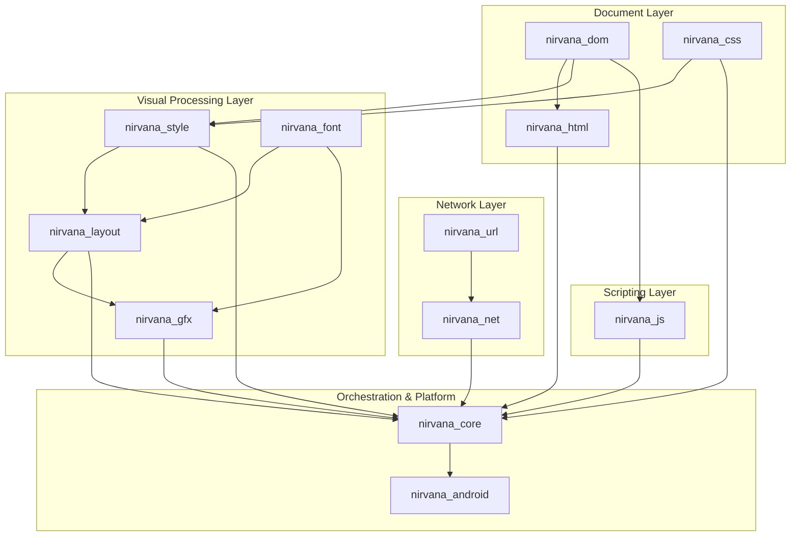

# Nirvana Browser Engine — Architecture Manual

## 1. Design Rationale & Philosophy

Modern mobile browsers on Android predominantly rely on massive C++ runtimes such as Google Chromium (via Android WebView) or Mozilla Gecko (via GeckoView). While feature-rich, these engines introduce significant trade-offs for privacy-centric browsers like Nirvana:

1. **Massive Binary Footprint:** GeckoView / Chromium libraries typically exceed 60–100MB of compiled native code.
2. **Memory Safety Hazards:** Millions of lines of legacy C/C++ expose memory safety vulnerabilities (buffer overflows, use-after-free, pointer corruption).
3. **Complex C++ Build Systems:** Building and customizing Chromium or Gecko requires extensive toolchains, hours of compilation time, and tight coupling with Google or Mozilla services.

**Nirvana Browser Engine** solves these challenges by providing a sovereign, pure-Rust engine:
- **Strict Memory Safety:** All 11 core crates enforce `#![forbid(unsafe_code)]`. Memory safety is mathematically verified by the Rust borrow checker.
- **Ultra-Lightweight Footprint:** Modular crate design yielding native binaries under 10MB when compiled with link-time optimization (LTO).
- **Zero Host Toolchain Friction:** Compiles purely through standard `cargo` with zero C/C++ compiler (`cl.exe`) dependencies.

---

## 2. Workspace Topology & Crate Responsibilities

The engine architecture follows a layered micro-crate topology where every crate has a well-defined boundary:

### 2.1. `nirvana_url` (RFC 3986)
- Pure Rust implementation of Uniform Resource Identifiers.
- Parses scheme, authority, host, port, path, query parameters, and fragments.
- Implements RFC 3986 Section 5 reference resolution algorithm for joining relative URLs to base documents.

### 2.2. `nirvana_dom` (Arena DOM Storage)
- Index-based arena storage using strongly-typed `NodeId`.
- Eliminates memory cycles and reference-counting overhead: elements are stored in a contiguous `Vec<Node>`, and parent/child relationships are stored as integer indices.
- Supports Element, Text, Comment, and Document root node types.
- Mutation tracking flags allow the engine to detect when JavaScript has updated the DOM tree and trigger incremental re-styling.

### 2.3. `nirvana_html` (WHATWG HTML5 Parsing)
- Complete tokenization engine supporting tags, self-closing tags, character references, comments, and doctypes.
- Depth-guarded tree builder with `MAX_TREE_DEPTH = 512` and excess depth tracking to prevent thread stack exhaustion on adversarial inputs.
- Resilient recovery from unclosed tags, malformed entities, and unexpected nesting.

### 2.4. `nirvana_css` (CSS3 Syntax & Specificity)
- CSS tokenizer and selector parser supporting type, class, ID, and compound selectors.
- CSS Specificity calculation strictly adhering to CSS3 specifications `(a, b, c)`:
  - `a`: Number of ID selectors.
  - `b`: Number of class and attribute selectors.
  - `c`: Number of element/tag selectors.
- Supports length units (`px`, `em`, `rem`, `%`), hex/rgb colors, and font specifications.

### 2.5. `nirvana_style` (Cascade & Inheritance)
- Matches DOM nodes against selector rulesets.
- Applies CSS Cascade ordering: User-Agent default stylesheet -> User styles -> Author stylesheets -> Inline `style` attributes.
- Implements CSS inheritance rules: inherited properties (`color`, `font-size`, `font-family`, `line-height`) flow naturally from parent nodes to children.
- Produces an immutable `StyleTree` mapping each `NodeId` to a `ComputedValues` record.

### 2.6. `nirvana_layout` (Geometry & Box Model)
- Generates layout boxes: Block formatting context, inline formatting context, and anonymous block boxes.
- Calculates box metrics: margins, borders, padding, and content bounds.
- Word-wrapping algorithm: computes word metrics using `nirvana_font` and breaks lines dynamically to respect viewport widths.
- Computes scrollable document heights (`max_scroll_y`) and hit-testable bounding boxes.

### 2.7. `nirvana_font` (Vector Typography)
- Font rasterization powered by pure-Rust `ab_glyph`.
- Embedded high-legibility default typeface ensuring font availability on any platform without external dependencies.
- Sub-pixel positioning and glyph baseline alignment.

### 2.8. `nirvana_gfx` (Software 2D Canvas & Display List)
- 32-bit RGBA pixel canvas with alpha blending.
- Intermediate `DisplayList` representation: decouples layout from rasterization, enabling fast viewport scrolling without re-layout.
- Software decoding for PNG and JPEG images with safety guards (`MAX_IMAGE_DIMENSION = 8192px`).

### 2.9. `nirvana_js` (Boa ECMAScript Engine & Bindings)
- Integrates the pure-Rust `boa_engine`.
- Exposes standard DOM interfaces: `document.getElementById`, `document.querySelector`, `textContent`, `setAttribute`, `getAttribute`.
- Supports cooperative timer event loop: `setTimeout`, `setInterval`, `clearTimeout`, `clearInterval`.
- Origin-isolated Web Storage: `window.localStorage` and `window.sessionStorage`.
- Cookie access via `document.cookie` with RFC 6265 `HttpOnly` security isolation.

### 2.10. `nirvana_net` (Pure-Rust TLS & Web Security)
- HTTP/HTTPS client leveraging `ureq` and `rustls` (zero OpenSSL / C library dependencies).
- RFC 6265 compliant `CookieJar` supporting `HostOnly`, `HttpOnly`, `Secure`, `Path`, and expiration policies.
- Same-Origin Policy (SOP) origin parsing and comparison.
- Content-Security-Policy (CSP) parsing and directive enforcement (`style-src`, `img-src`, `script-src`).
- Mixed-content detection preventing insecure HTTP subresource loads from HTTPS documents.

### 2.11. `nirvana_core` & `nirvana_android` (Orchestration & NDK)
- Unified `NirvanaEngine` coordinating the complete pipeline.
- High-resolution `FrameMetrics` performance telemetry tracking parse, style, layout, and raster times.
- Safe JNI C-ABI interface with `std::panic::catch_unwind` shielding Java from native crashes.

---

## 3. Memory & Threading Model

1. **Single-Threaded Engine Core:** A `NirvanaEngine` instance is designed to run on a dedicated render/worker thread or the Android UI thread. This avoids multi-threading lock contention.
2. **Arena Allocations:** The DOM tree uses a single vector arena. Nodes are created via index assignment, preventing heap fragmentation and cache misses.
3. **Safe Memory Reclamation:** The engine exposes explicit cache pruning (`clear_image_cache()`) and memory compaction (`shrink_to_fit()`). Destroying an engine via JNI cleanly deallocates all native heap structures.
